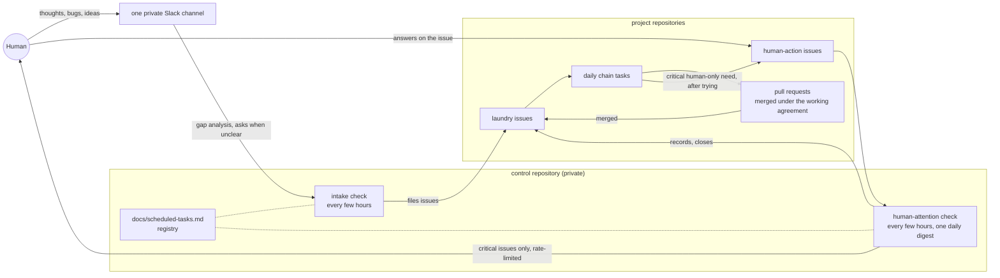

# loop-kit

**Bootstrap loop engineering into any codebase in one command.**

A structured starter kit that adds the five pieces of [loop engineering](https://addyosmani.com/blog/loop-engineering/) to your project — memory, skills, sub-agents, automations, and worktrees — a sixth piece, human attention (the human is reached only through human-action issues that meet a bar, by a scheduled check), plus the [Karpathy disciplined coding](https://github.com/multica-ai/andrej-karpathy-skills/blob/main/CLAUDE.md) operating principles.

```
curl -fsSL https://raw.githubusercontent.com/matheo-lm/loop-kit/main/scripts/loop-init.sh | bash
```

That's it. A handful of small files land in your repo. The agent reads them, understands how to operate, and the loop begins.

---

## Why

Until mid-2026, getting work out of a coding agent meant writing a good prompt every time. You type, it responds, you type again. The agent is a tool and you are holding it.

Loop engineering changes that. You design a system that finds the work, hands it out, checks it, writes down what's done, and decides the next thing — and you let that system poke the agents instead of you.

> "I don't prompt Claude anymore. I have loops running that prompt Claude and figuring out what to do. My job is to write loops." — Boris Cherny, head of Claude Code at Anthropic

Loop-kit gives you the pieces, ready to drop in:

| Piece | File | What it does |
|-------|------|-------------|
| **Memory** | `STATE.md` + GitHub issues labelled `laundry` | Persistent session state and a ranked backlog in issues (`docs/laundry_list.md` says how). Agent reads at start, writes at end. The model forgets; the repository doesn't. |
| **Skills** | `skills/*/SKILL.md` | Codified project knowledge. Conventions, build steps, rationale — written once, read every run. |
| **Sub-agents** | `.agents/reviewer.md` | Maker/checker separation. One writes, a second verifies. |
| **Automations** | `.github/workflows/loop-triage.yml` | Scheduled discovery and triage without human prompting. |
| **Worktrees** | `AGENTS.md` | Documented `git worktree` pattern for parallel agents. |
| **Chains** | `docs/laundry-chain.md` | Multi-session runs: one bundle per session, PR title as lock, session limit, queue, chain log, hand-off to the next session. |
| **Human attention** | `skills/human-attention/SKILL.md`, `.github/ISSUE_TEMPLATE/human-action.md`, `docs/attention-check.md` | A human-only need is asked live when the human is in the chat, recorded on the issue with the `waiting-on-human` label when nobody can answer, and filed as a `human-action` issue only when it is critical and meets a five-point bar. A scheduled check carries critical issues to the human with rate limits; answers come back as recorded decisions. |
| **Intake** | `skills/intake/SKILL.md`, `docs/intake.md` | The human dumps thoughts, bugs, ideas and feedback in one private Slack channel; a scheduled check turns each message into a laundry item in the right repository after a gap analysis, asks in the thread when the ask is unclear, and never does the work. |

### One control repository for many

When one person runs the loop across several repositories, the two cross-repository pieces live once: the human-attention check and the intake check run from a private **control repository**, which also keeps `docs/scheduled-tasks.md`, the registry of every scheduled task (id, schedule, repositories and connectors attached, prompt source, environment facts learned from runs). Project repositories keep their own chain brief, `chain-task.md` and `human-attention` skill, because filing is local and chains are per repository. Cross-repository human-only needs are filed in the control repository.

### The loop in one picture



Inbound (the channel), work (the chains), outbound (the queue). The human writes in one place and answers in one place; everything else is files in repositories.

Plus the **Karpathy operating principles** at the top of `AGENTS.md` (think before coding, simplicity first, surgical changes, goal-driven execution) and the **two human gates** in `SESSION.md` (frame before code, ship at the PR — nothing in between). `AGENTS.md` also carries the **stay-the-engineer** list (production writes asked each time, outward publishing, data deletion, payments, auth), the **question rules** (structured question tool, one recommended option, unanswered questions recorded instead of guessed) and **confidence disclosure** ("Confidence Level x%" whenever confidence is below 97%).

---

## What gets created

After running the bootstrap, your repo gets:

```
SESSION.md                        ← session-start prompt (give this to your agent)
AGENTS.md                         ← operating model + principles
STATE.md                          ← session memory
docs/laundry_list.md              ← how the backlog lives in GitHub issues (label laundry, P0 to P3)
docs/done_laundry_list.md         ← finished work is a closed issue
docs/laundry-chain.md             ← multi-session chain brief
docs/chain-task.md                ← pasteable prompt of the repository's daily chain task (fill in)
docs/attention-check.md           ← human-attention check prompt (schedule it hourly)
docs/intake.md                    ← intake check prompt (schedule it every few hours, Slack connector attached)
docs/scheduled-tasks.md           ← registry of scheduled tasks (fill in; one per loop, in the control repository)
skills/disciplined-coding/SKILL.md ← disciplined coding skill
skills/design/SKILL.md            ← frontend design skill
skills/usability-heuristics/SKILL.md ← usability evaluation skill
skills/surface-verification/SKILL.md ← runtime-observation verification skill
skills/human-attention/SKILL.md   ← when and how the human is reached
skills/intake/SKILL.md            ← turning the human's channel messages into laundry items
.agents/reviewer.md               ← code review sub-agent
.agents/security-auditor.md       ← security audit sub-agent
.github/workflows/loop-triage.yml ← scheduled triage (manual-only until you enable the cron)
.github/ISSUE_TEMPLATE/human-action.md ← human-action issue template
.claude/skills/*                  ← Claude Code skill symlinks (committed — portable setup)
```

**AGENTS.md** is the spine. It contains:
- Operating Principles (Karpathy's 4 rules)
- Loop Engineering methodology (the 5 pieces + session workflow)
- Placeholders for your project's structure, commands, and conventions

Fill in the placeholders, commit, and the loop is ready to run.

---

## How to use

### One-shot setup

```bash
curl -fsSL https://raw.githubusercontent.com/matheo-lm/loop-kit/main/scripts/loop-init.sh | bash
```

Then edit `AGENTS.md` with your project's:
- Build/test/typecheck commands
- Project structure
- Coding style conventions
- Testing guidelines

### Start every session with this prompt

After setup, **`SESSION.md` is what you give your agent** at the start of each session. It tells the agent:

```
Read AGENTS.md → read STATE.md + the open laundry issues → run 5-phase operating loop → ship PR → loop
```

Open your agent's chat/terminal and paste:

```
Read SESSION.md and follow it. The project is at <path-to-repo>.
```

Or reference the file path directly if your agent supports file reading:

```
Read <path-to-repo>/SESSION.md and follow it.
```

The agent then runs the full ritual: gather evidence, build candidates, commit to one item, implement, verify, bookkeep, and loop until done.

---

### Two-shot with audit

```bash
curl -fsSL https://raw.githubusercontent.com/matheo-lm/loop-kit/main/scripts/loop-init.sh | bash
# then manually:
# then file the audit's findings as issues labelled laundry
```

Run a deep audit of your codebase (grep for common issues, inspect components, check test coverage) and file the findings as GitHub issues labelled `laundry` with a priority label (`docs/laundry_list.md` says how). This gives the agent a ranked backlog to work from.

### Add project skills

Domain-specific skills go under `skills/<name>/SKILL.md`. Loop-kit ships with four starters — `skills/disciplined-coding/SKILL.md`, `skills/design/SKILL.md` (adapted from [Anthropic's frontend-design skill](https://agenticskills.io/skills/frontend-design)), `skills/usability-heuristics/SKILL.md` (the Nielsen/Norman/Shneiderman/Rams canon condensed into a severity-rated evaluation method; structure inspired by [jpoindexter/design-and-ai-skills](https://github.com/jpoindexter/design-and-ai-skills)), and `skills/surface-verification/SKILL.md` (verification as runtime observation — tests prove assertions, only watching the running artifact proves the change works). Add more:

```
skills/
  disciplined-coding/SKILL.md      ← implementation rigor (included)
  design/SKILL.md                  ← frontend design (included)
  usability-heuristics/SKILL.md    ← heuristic evaluation (included)
  react-best-practices/SKILL.md    ← Vercel's 70 React rules
  react-native-best-practices/     ← Callstack's RN perf guide
  systematic-debugging/            ← 4-phase debug methodology
  webapp-testing/                  ← Playwright testing guide
```

Every skill carries YAML frontmatter (`name`, `description`) so agent tools can discover it. The bootstrap creates `.claude/skills/` symlinks automatically for Claude Code — commit them, the setup is meant to be portable. When you add a new skill, link it the same way:

```bash
ln -s ../../skills/<name> .claude/skills/<name>
```

### Run a chain

Fill in the placeholders in `docs/laundry-chain.md` (session limit, merge policy, off-limits work), seed "Queue" with the first bundle, then start a session with:

```
Continue the laundry-list chain: read docs/laundry-chain.md and run the next session.
```

Each session runs one bundle, logs it, queues the next and starts the next session. A daily scheduled run with the same prompt keeps it going; the PR-title lock stops two sessions from overlapping.

---

## What Claude Code cloud sessions refuse (observed 2026-10-24)

Design the loop around these; none of them is a bug to work around.

- A scheduled task created from a session carries no repositories or connectors; both are attached only in the Routines UI, and unattended sessions are refused `add_repo`. Record what the human attached in `docs/scheduled-tasks.md`.
- The auto-mode permission classifier may refuse to store a task prompt that merges without review. Keep the prompt in a doc (`docs/chain-task.md`, `docs/attention-check.md`, `docs/intake.md`) and let the human paste it, or have them grant a permission rule for the trigger tools once.
- GitHub GraphQL is unavailable (`gh issue`, `gh pr`, issue transfers); REST (`gh api`) works, and draft-to-ready goes through `POST repos/O/R/pulls/N/ccr/ready_for_review`. `gh auth status` reports the token as invalid while `gh api` works.
- Agent tokens cannot write `.github/workflows/` (no `workflow` scope): stage workflow files under `workflows/` and let the human copy them. Repository-settings writes, repository creation and branch deletion through the API are refused by the proxy; turn on "Automatically delete head branches" per repository instead of deleting branches.
- Routine-fired sessions have no `create_session` or `list_sessions`, so a scheduled task cannot dispatch other sessions: each task does its own work in place, and a running chain is known by its open draft PR (the lock), not by session tags. A routine-fired session has none of the claude-code-remote tools (`fire_trigger`, `create_trigger`, `send_later`, `create_session`...; probed 2026-10-25), so routines cannot kick routines: the schedule is the only kick, and a run with nothing to do must exit cheaply. A run that hits the account's usage limit fails within seconds and does nothing.

## Agent workflow

Every session follows the phased loop in `SESSION.md`:

```
SESSION.md → AGENTS.md → STATE.md + laundry issues → gather evidence → build candidates →
commit to one → implement → verify → review → bookkeep → ship PR → loop
```

The loop has exactly two gates:

1. **Frame** — before code, the agent asks the human if the item is ambiguous or touches the STOP list (payments, auth, data deletion, irreversible public behavior).
2. **Ship** — the PR, with verification evidence (commands + output) in the body, reviewed by an independent agent whose findings are fixed; the PR then merges itself under the repository's merge conditions. The human never reviews code or pull requests and is asked only for owner-only decisions.

Between the gates, the agent runs to completion — no "shall I proceed?", no intermediate sign-offs. Everything else — planning, implementation, verification, review, bookkeeping, looping — is the agent's part.

---

## Philosophy

Loop-kit is built on three convictions:

1. **The model forgets; the repo doesn't.** Everything important lives on disk — not in context. State, skills, and principles are files, not prompts.

2. **The agent that writes should never be the agent that grades.** Sub-agents with different instructions catch what the implementer talked itself into.

3. **Simple > clever.** A markdown file for memory is dumber than a vector database. It also works every time, costs nothing, and every agent can read it.

---

## Project status

This is a starter kit, not a framework. It gives you the files and the pattern. You supply the project-specific conventions, build commands, and domain expertise.

The templates are universal — they work with any coding agent (Claude Code, opencode, Codex, Cursor, Copilot) and any language or stack.

---

## License

MIT
